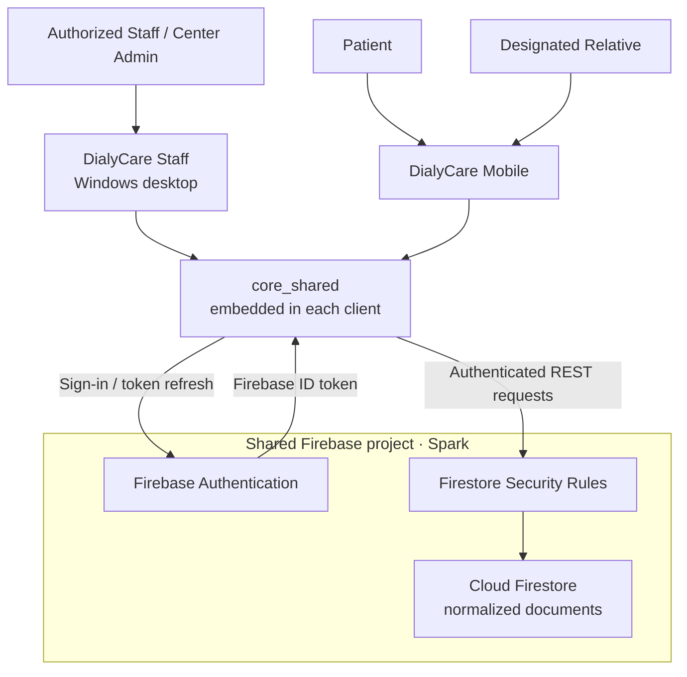
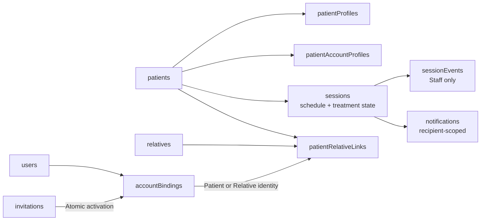
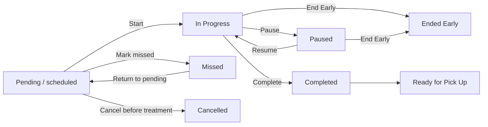

# DialyCare

**Dialysis Center Management and Patient Coordination System**

> A connected Staff and Mobile platform for dialysis scheduling, session monitoring, patient coordination, and care updates.


**Staff:** Windows desktop · **Patient & Relative:** Mobile · **Backend:** Firebase Authentication + Cloud Firestore

[Overview](#-system-overview) · [Features](#-key-features) · [Architecture](#-system-architecture) · [Data](#-data-architecture) · [Run](#-how-to-run-the-application) · [Testing](#-testing) · [Security](#-security-and-privacy) · [Deployment](#-build-and-deployment)

## 🏥 System Overview

DialyCare connects authorized dialysis-center Staff and Admin users with Patients and their designated Relatives. Staff maintain patient records, assign appointments, manage treatment-session states, and publish care-coordination updates. Mobile users view only the records and notifications authorized for their account and current care relationship.

Both applications use the same Firebase project and authoritative Firestore records. The current runtime uses the Firebase **Spark** plan, Firebase Authentication, and authenticated Firestore REST requests. Running the apps does not require a separate backend server, deployed Cloud Functions, or a Blaze upgrade.

This repository is a working development/capstone system. It does not establish clinical certification, regulatory compliance, or readiness for unrestricted production deployment.

## 🖥️ System Components

| Component | Purpose | Main interface |
| --- | --- | --- |
| **DialyCare Staff** | Authorized Staff/Admin workspace for center operations | Dashboard, Patients, Schedules, Sessions, Notifications, Feedback & Concerns, Reports/History, Settings |
| **DialyCare Mobile** | One application with separate Patient and designated Relative access | Home, Feedback, History, More; Schedule and Notifications remain accessible from Home |
| **core_shared** | Shared Dart/Flutter package embedded in both clients | Session models, timing, account policies, authenticated repositories, shared avatars |
| **backend** | Firebase configuration, Security Rules, tests, and trusted maintenance tools | Rules/index deployment and explicitly invoked development/admin scripts |

Staff sign in with an approved Firebase email/password account and trusted Staff/Admin role mapping. There is no public Staff signup. Patients and Relatives activate with their center-issued ID and Temporary PIN, then sign in with that ID and their chosen password.

The Mobile project includes Android, iOS, Windows preview, and web runners. Staff includes Windows and web runners. Windows is the primary Staff target; iOS execution requires macOS/Xcode and has not been verified on this Windows development machine.

## ✨ Key Features

### Patient Management

- Personal, designated Relative, and medical-information forms, including optional measurements, PhilHealth number, and MDR status.
- Permanent center-issued Patient and Relative IDs, with reservations retained when identities are archived or retired.
- Canonical Patient IDs use `DP-YYYY-NNN`, with a separate sequence per issuance year. The conditionally authorized existing-Patient migration stopped before writes on a safety check and remains incomplete; new Patient registration stays guarded until it completes. Relative `R-` IDs stay unchanged. See the [migration and rollout guide](dialycare_workspace/backend/HISTORY_AND_CANONICAL_IDS.md).
- Staff-controlled Mobile Access creation, status refresh, disable/restore, and pending PIN regeneration/cancellation.
- Gender-based default Patient avatars with a neutral fallback for other, blank, or unknown values.

### Scheduling

- Date-based appointments grouped by batch, with Patient selection and an initial regular-day-group filter.
- Room, time, batch, and planned treatment duration on each appointment; overlapping appointments are rejected.
- Center Admin batch configuration with optional hours/capacity and active state.
- Revision checks that reject stale concurrent workspace saves.

### Dialysis Session Monitoring

- Staff actions for Start, Pause, Resume, Complete, End Early, and pre-treatment cancellation.
- Elapsed active-treatment time, estimated end, and progress derived from persisted timing.
- Private Staff session-event history, including interruption reasons and internal notes.
- Pause time excluded from active treatment; completion always remains an explicit Staff action.

### Patient & Relative Mobile Access

- Role selection and first-time activation with a center-issued ID and expiring Temporary PIN.
- Authorized schedule, session status/progress, and notification views.
- Patient profile information and designated Relative summaries within the permitted projections; Relatives see their linked Patient's coordination information.
- Account/security information, password change through reauthentication, and Terms/Privacy acknowledgment during activation.

### Notifications

Persisted **in-app** notifications support reminders and session updates, including pickup coordination. Recipient read timestamps and Staff read state are tracked separately. Foreground refresh and manual refresh retrieve updates.

Background push delivery and SMS sending are **not configured in the current runtime**. Messaging dependencies and legacy provider abstractions do not establish working device delivery.

### Feedback & Concerns

Patients and designated Relatives can submit authenticated tickets from the bottom **Feedback** destination. Staff use the dedicated inbox to review, respond, resolve, and close concerns. Original messages and chronological responses are retained; access follows the current account and Patient relationship. Updates use existing in-app notifications. See the [workflow, security, deployment, and verification guide](dialycare_workspace/backend/FEEDBACK_CONCERNS.md). The reviewed Spark Rules were deployed separately on 24 October 2026; another environment must verify its active policy before connected use.

Staff **Reports → History** and the Mobile bottom **History** destination provide authorized terminal-session, future schedule-change and resolved-concern history. Staff return with **Back**; the existing Reports overview is retained. Both apps share a compact date-range calendar with highlighted endpoints, Cancel/Apply and an explicit selected-range label. Staff also see communication metadata. Clinical notes and technical audit logs are excluded from Mobile History. Earlier schedule edits are not reconstructed. See [History and canonical IDs](dialycare_workspace/backend/HISTORY_AND_CANONICAL_IDS.md).

### Reports

Staff can filter session summaries by date range and batch, view total/completed/missed counts, and open details for completed or missed sessions. Reports use the same shared session records as the operational screens. PDF/CSV export is not implemented in this screen.

## 🏗️ System Architecture



`core_shared` is a client library, not a separately hosted service. Firestore requests carry Firebase ID tokens and remain subject to Security Rules. Staff perform coordinated writes with revision/precondition checks; Mobile accounts cannot control clinical session state.

**Synchronization:** foreground refresh runs approximately once per minute and skips inactive windows. Cached histories have a five-minute full-refresh fallback, while Mobile access and relationship checks precede cached data. Pull-to-refresh forces retrieval. Quota errors pause requests for 15 minutes. This is periodic refresh, not a Firestore snapshot subscription; the one-second session display clock makes no network request or database write.

## 🗄️ Data Architecture

Scheduling and operational treatment state share **`sessions`**. There is no separate `schedules` collection or independent Mobile Patient database. Public display/login IDs are distinct from internal document IDs and Firebase Auth UIDs.

| Firestore path | Responsibility / access boundary |
| --- | --- |
| `patients/{id}` | Authoritative Staff-only personal and clinical records |
| `relatives/{id}` | Relative identity/contact records; Staff and the authorized current Relative can read |
| `patientRelativeLinks/{id}` | Current Patient–Relative relationship and authorization link |
| `patientProfiles/{id}` | Minimal shared Patient coordination projection; authorized readers only |
| `patientAccountProfiles/{id}` | Patient-only contact/designated Relative summary, also accessible to Staff |
| `sessions/{id}` | Planned appointment, operational status, treatment timing, and revision |
| `sessionEvents/{id}` | Append-only Staff-only operational history and reasons/notes |
| `notifications/{id}` | Recipient-scoped messages, recipient read time, and separate Staff read state |
| `feedbackConcerns/{id}` | Authenticated submissions, immutable original content, and Staff-controlled workflow |
| `feedbackConcerns/{id}/responses/{id}` | Append-only Staff responses, visible only to authorized Staff and the current authorized submitter |
| `users/{uid}` | Approved role and immutable care-identity mapping |
| `accountBindings/{key}` | Pending/active/disabled Mobile access and activated ownership |
| `invitations/{code}` | Private PIN-derived activation lookup, expiry, and single-use acceptance |
| `publicIds/{publicId}` | Permanent display/login ID reservations |
| `idCounters/center` | Legacy Patient and current Relative public-ID counters |
| `idCounters/patients-YYYY` | Annual sequence for new Patient public IDs |
| `batches/{id}` | Center Admin treatment-slot configuration |
| `settings/center` | Center contact/details maintained by Center Admin |
| `policyAcceptances/{uid}` | Versioned Terms agreement and Privacy acknowledgment |
| `auditEvents/{id}` | Constrained append-only application audit events, readable by Staff |
| `clinical/state` | Workspace revision metadata and Staff summary/event coordination; no duplicate clinical snapshot |



Arrows indicate logical relationships, not Firestore subcollections. Projections are permission-limited views maintained with the authoritative records. Mobile queries are scoped by Patient or recipient identity. Current queries use equality filtering and client-side sorting; `firestore.indexes.json` currently declares no composite indexes or field overrides.

## 📅 Regular Day Groups and Batches

| Concept | Meaning | Implemented behavior |
| --- | --- | --- |
| **MWF** | Monday, Wednesday, Friday regular dialysis group | Used for Patient grouping and appointment eligibility filtering |
| **TThS** | Tuesday, Thursday, Saturday regular dialysis group | Stored as `TTHS`; displayed as TThS |
| **Batch** | Daily treatment time slot/shift | Separate from regular-day grouping; configured by Center Admin |

Sunday has no regular group. Staff explicitly select appointments; group membership does not automatically create future schedules. The group filter can be disabled for an approved exception. Batch C appears when configured or required by existing appointments. Deactivated batches retain visibility for existing appointments, and the app does not invent center capacity when none is configured.

## ⏱️ Dialysis Session Workflow



Staff control these transitions; Patients and Relatives receive authorized read-only updates. Pause intervals survive reload and are subtracted from active elapsed time. Progress reaching 100% does not complete treatment automatically. Completed/ended-early treatment duration stays fixed. Existing legacy `Waiting` records remain supported; `Resumed` is an action returning to **In Progress**, not a separate stored status.

## 📁 Project Structure

```text
dialycare_workspace-main/
├── README.md
├── .gitignore
└── dialycare_workspace/
    ├── dialycare_staff/
    │   ├── lib/                 # Screens, models, services, widgets, theme
    │   ├── assets/images/
    │   ├── test/ and integration_test/
    │   ├── windows/ and web/
    │   ├── firebase.json
    │   └── pubspec.yaml / pubspec.lock
    ├── dialycare_mobile/
    │   ├── lib/                 # App, Mobile store, Firebase options
    │   ├── assets/images/ and test/
    │   ├── android/, ios/, windows/, web/
    │   ├── firebase.json
    │   └── pubspec.yaml / pubspec.lock
    ├── core_shared/
    │   ├── lib/                 # Repositories, accounts, timing, governance
    │   ├── assets/ and test/
    │   └── pubspec.yaml
    └── backend/
        ├── firebase.json / firebase.spark.json / .firebaserc
        ├── firestore.spark.rules   # Current configured Security Rules
        ├── firestore.rules         # Retained legacy rule file
        ├── firestore.indexes.json
        ├── *.cjs                   # Tests and trusted maintenance tools
        ├── tools/ and policies/
        ├── functions/              # Legacy Functions adapter and tests
        └── package.json / package-lock.json
```

The workspace root and `core_shared` are not runnable apps. The existing Mobile project was renamed from `dialycare_patient`; some native package/binary identifiers retain that older name. Generated builds, local screenshots, operational reports, dependencies, and `tmp/` are intentionally excluded from Git.

## 🛠️ Technology Stack

| Component | Technology |
| --- | --- |
| Staff and Mobile interfaces | Flutter, Dart, Material widgets |
| Shared client code | Local `core_shared` Dart/Flutter package |
| Authentication | Firebase Authentication; Firebase ID tokens |
| Database access | Cloud Firestore REST API through shared authenticated repositories |
| Authorization | Firestore Security Rules and current account/relationship bindings |
| Current Firebase plan | Spark; existing shared Firebase project |
| Flutter verification | Flutter analyzer, unit/widget tests, integration harnesses |
| Backend verification | Node.js test runner, Firebase Emulator Suite, Rules unit testing |
| Version control | Git / GitHub |

## 🔑 Test / Demo Accounts

Production credentials and activation PINs are not published in this repository. Obtain authorized demonstration access from the project/center owner; there is no universal public demo login.

`backend/synthetic-dataset.cjs` defines 43 explicitly invented development Patient/Relative pairs. The seed source does not activate accounts or assign passwords. Do not rerun live seeding, migrations, cleanup, or live-verification tools just to start the apps.

For a local **Staff UI preview** using sample data, the existing development mode is available:

```powershell
# From dialycare_workspace/dialycare_staff
flutter run -d windows --dart-define=DIALYCARE_CLOUD=false
```

This mode does not synchronize its local sample workspace with Firebase and does not provide a connected Mobile demo.

## 🚀 How to Run the Application

### Prerequisites

- Git and a Flutter SDK whose bundled Dart satisfies **`>=3.13.2 <4.0.0`**. The verified environment is **Flutter 3.47.6 / Dart 3.13.5**.
- For Windows: Visual Studio with the **Desktop development with C++** workload and a Windows SDK. VS Code alone does not supply the native build toolchain.
- For Android: Android SDK/tooling and an attached device or emulator; the checked-in Android build targets Java/Kotlin JVM 17.
- For iOS: macOS, Xcode, and the required Apple build/signing tools. iOS has not been verified on this Windows host.
- For connected use: network access to the configured Firebase project, Email/Password authentication enabled, deployed current Rules, and a trusted Staff mapping or valid Mobile activation.

Node.js, Firebase CLI, and Java for emulators are development/deployment tools; no local Node server is required for normal app startup. The legacy Functions package declares Node.js 22.

### Clone and check the toolchain

```powershell
git clone https://github.com/Shnnleiogrmn/dialycare_workspace.git
cd dialycare_workspace
flutter doctor
flutter devices
```

The clone directory above is the repository root and contains another directory named `dialycare_workspace`. Run each block below from the repository root. If the checkout is named `dialycare_workspace-main`, use that folder as the root instead.

### 🖥️ Run DialyCare Staff

```powershell
cd dialycare_workspace/dialycare_staff
flutter pub get
flutter run -d windows
```

Sign in with an approved Staff account. Firebase Auth success alone is insufficient: the matching `users/{uid}` mapping must have an approved Staff/Admin role, active account status, and access enabled.

### 📱 Run DialyCare Mobile

```powershell
cd dialycare_workspace/dialycare_mobile
flutter pub get
flutter devices
flutter run
```

Select the attached Android device/emulator, or pass its ID using `flutter run -d <device-id>`. Windows preview is available with `flutter run -d windows`. On macOS, select a configured iOS simulator/device.

First-time access:

1. Staff save the Patient and designated Relative, then create access in **Patient Details → Mobile Access**.
2. Staff give the correct public ID and the one-time Temporary PIN directly to the approved person. PINs expire after 24 hours; no email/SMS is sent.
3. The owner chooses Patient or Relative, verifies the ID/PIN, creates an 8–16 character password, and completes Terms/Privacy acknowledgment.
4. Subsequent login uses the ID and chosen password. A retired Relative relationship does not transfer login ownership to its replacement.

Both apps resolve `core_shared` through `path: ../core_shared`; keep the workspace folders together.

## 🧪 Testing

Run analysis and tests in each Flutter package. From the repository root:

```powershell
$repoRoot = (Get-Location).Path
$projects = @("core_shared", "dialycare_staff", "dialycare_mobile")
foreach ($project in $projects) {
    Push-Location (Join-Path $repoRoot "dialycare_workspace/$project")
    try {
        flutter pub get
        if ($LASTEXITCODE -ne 0) { throw "Dependency resolution failed: $project" }
        flutter analyze
        if ($LASTEXITCODE -ne 0) { throw "Analysis failed: $project" }
        flutter test
        if ($LASTEXITCODE -ne 0) { throw "Tests failed: $project" }
    } finally {
        Pop-Location
    }
}
```

Latest complete Flutter suites and local backend verification on **25 October 2026**:

| Project | Analysis | Tests |
| --- | --- | --- |
| `core_shared` | No issues | 51 passed |
| `dialycare_staff` | No issues | 74 passed; 3 integration tests skipped without explicit harnesses |
| `dialycare_mobile` | No issues | 20 passed |
| Local backend API/synthetic-data/migration tests | Not a Dart project | 26 passed |

The local Firestore emulator passed all 43 Rules/activation/Feedback/History cases, with no failures or skips. These results are separate from the 145 ordinary Flutter test passes and 26 local backend passes. The dedicated Auth/Firestore harness additionally passed both conditional repository workflows; the production live harness was not run. A working JDK is required for emulators. Staff and Windows-hosted Mobile release builds succeeded, with a non-blocking native linker warning; Android/iOS builds were not repeated in this validation. The reviewed Spark Rules were deployed separately on 24 October 2026; the actual Patient-ID migration remains safely stopped and incomplete. This GitHub update does not deploy Firebase resources or modify live records.

Local backend tests, from the repository root:

```powershell
Push-Location dialycare_workspace/backend
try { npm run test:local } finally { Pop-Location }
```

Rules tests require Node dependencies, Firebase CLI, and the Firestore emulator on `127.0.0.1:8089`. From `dialycare_workspace/backend`:

```powershell
npm ci
firebase emulators:exec --only firestore --config firebase.spark.json --project demo-dialycare-spark "npm run test:rules"
```

The Staff repository integration tests require their explicit local emulator/auth harnesses; live verification requires its disposable-fixture runner. Plain `flutter test` skips these deliberately. Local API tests use an in-memory adapter and do not establish deployed Firebase or FCM delivery. Live tools are privileged, separately authorized operations.

## 🔒 Security and Privacy

- Firestore access is denied by default. Current role, account status, Patient archival state, and Relative relationship determine permitted reads/writes.
- Full clinical Patient documents and private session-event reasons/notes remain Staff-only. Mobile receives limited projections and scoped session/notification records.
- Activation binds the authenticated UID to the exact approved identity through an expiring, single-use, rules-validated atomic claim. Raw PINs and chosen passwords are not stored in Firestore.
- Permanent public IDs are reserved atomically; changing a Mobile screen cannot self-assign Staff privileges or a new Relative relationship.
- Firebase client configuration (`firebase_options.dart`, `google-services.json`) is required application configuration. It is not a Firebase Admin credential and does not replace authorization Rules.
- Service-account keys, privileged tokens, `.env` secrets, signing keys, database exports, operational Patient/Relative outputs, logs, and temporary evidence must remain outside commits. The root `.gitignore` covers the known local outputs; review new files before staging.

**Deployment boundaries:** this client/Rules architecture has no trusted per-record PIN guessing limiter or privileged recovery service. An unlinked Auth alias can require trusted ownership repair; it grants no care role by itself. Mobile password recovery requires center identity verification and trusted recovery, while Staff retain their Firebase email-recovery flow. Automated backups and restore drills are not configured/verified. Security/privacy review and operational readiness work remain necessary before production use; no compliance certification is claimed.

## 📦 Build and Deployment

### Application builds

```powershell
# From dialycare_workspace/dialycare_staff
flutter build windows --release
```

```powershell
# From dialycare_workspace/dialycare_mobile: development/demo Android APK
flutter build apk --debug
```

Build output belongs under ignored `build/` folders. Android currently uses the example application ID and debug signing for its release build type; configure the intended identity and private release signing before distributing a production APK/AAB. iOS distribution requires separate Apple signing and platform verification. Successful local tests are not store/deployment certification.

### Firebase Rules and indexes

The existing configuration targets project `dialycare-backend-3f0ed`, database `(default)`, region `asia-southeast1`. Both backend Firebase configurations select **`firestore.spark.rules`**; `firestore.rules` is retained legacy code, not the configured deployment source.

Only an authorized project maintainer should deploy. After reviewing and testing the Rules/index changes, run from `dialycare_workspace/backend`:

The annual Patient ID update requires the reviewed Rules rollout before new connected Patient registrations. Existing issued identities are retained. See the [Patient ID transition guide](dialycare_workspace/backend/PATIENT_ID_TRANSITION.md) for compatibility and rollout details; committing or running the apps does not deploy Rules or migrate records.

```powershell
firebase login
firebase deploy --only "firestore:rules,firestore:indexes" --config firebase.spark.json --project dialycare-backend-3f0ed
```

This is a deployment command, not an app-startup prerequisite for an already configured environment. Existing Staff roles require trusted provisioning. Do not deploy `functions/`, run migrations/seeds, or create a second Firebase project as part of ordinary setup. Switching to another project requires coordinated client configuration, repository project settings, Rules, and account provisioning; changing a single client file is insufficient.

## 📚 Developer Handoff

- [Account activation, ownership, and recovery](dialycare_workspace/backend/ACCOUNT_SYSTEM.md)
- [Session controls, interruption history, and batch scheduling](dialycare_workspace/backend/SESSION_INTERRUPTION_GUIDE.md)
- [Staff session-management implementation](dialycare_workspace/dialycare_staff/SESSION_MANAGEMENT.md)
- [Current Firestore Security Rules](dialycare_workspace/backend/firestore.spark.rules)
- [Firestore index configuration](dialycare_workspace/backend/firestore.indexes.json)
- [Terms of Use](dialycare_workspace/backend/policies/capstone-2026-10-19-v1/TERMS_OF_USE.md) and [Privacy Notice](dialycare_workspace/backend/policies/capstone-2026-10-19-v1/PRIVACY_NOTICE.md), retaining their documented review status

The opening sections of the [Spark setup guide](dialycare_workspace/backend/SPARK_SETUP.md) and [backend README](dialycare_workspace/backend/README.md) describe the current runtime. Their explicitly historical sections include superseded email activation, bundled snapshots, polling intervals, and Functions/provider designs. Follow current source and the account/session guides when those older notes differ. Generated operational verification reports are local-only and are not public-repository dependencies.

## 🔭 Future Improvements

- Configure and verify background push delivery and an SMS provider before advertising either channel.
- Evaluate scoped listeners/pagination and larger-history performance within the project's quota constraints.
- Add trusted activation-abuse controls and a reviewed recovery process.
- Establish backup/restore procedures, production signing, platform distribution checks, and deployment monitoring.

These are follow-up work areas, not completed features.
